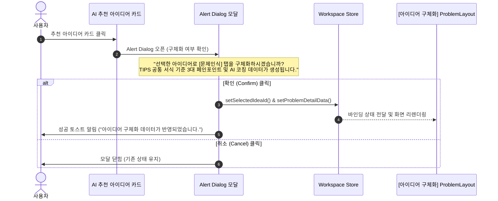

# 아이디어 선택 및 [아이디어 구체화] 탭 데이터 연동 진행 상황 명세서

## 1. 개요 및 요구사항 정의

본 문서는 AI LLM이 생성한 아이디어 카드를 클릭했을 때, 사용자의 확인을 거쳐 **[아이디어 구체화] (PSST 문제인식 레이아웃)** 영역으로 데이터를 바인딩 및 구체화하는 기능의 진행 상황과 데이터 규격을 정리한 문서입니다.

### 1.1 핵심 요구사항
1. **Alert Dialog 인터랙션**: AI LLM이 생성한 아이디어 데이터(카드 UI)를 클릭 시, Alert Dialog 모달을 띄워 유저에게 최종적으로 [아이디어 구체화] 탭에서 표시될 상세 데이터(문제인식, 페르소나, 페인포인트 악순환 고리, AI 코칭 피드백 등)를 생성/적용할 수 있도록 행동을 유도합니다.
2. **구체화 데이터 구조 수립**:
   - **문제인식 (Problem Statement)**: 클릭한 아이디어의 도출 근거 및 사회적/시장 배경을 요약 문장 대비 약 2배 분량의 충실한 문장으로 서술.
   - **핵심 타깃 페르소나 (Target Persona)**: MVP를 실제 사용할 가상 인물을 현실감 있게 정의하고, 페르소나 설정 근거인 3가지 페인포인트를 각각 20~25자 이내로 명확하게 제시.
   - **검증된 3대 페인포인트 악순환 고리 (Pain Point Cycle)**: `ProblemLayout` 컴포넌트 UI에 맞춰 단계별(1단계: 강제구매/대용량 번들, 2단계: 방치망각/재고망각, 3단계: 폐기손실/음식물 쓰레기화) 인과관계를 입체적으로 구조화.
   - **실시간 AI 검증 피드백 코칭 (AI Coaching Feedback)**: 문제인식, 페르소나, 3대 페인포인트를 종합하여 도출한 솔루션의 근거 문장(제시된 예시 문장보다 긴 상세 설명)과 함께, 비즈니스 모델(수익화) 연계 및 심사 통과를 위한 구체적인 AI 피드백 문장을 상세하게 도출.
3. **테스트 코드 및 데이터 구조 검증**: TypeScript 인터페이스 및 모의 데이터(Mock Data)를 통한 검증 코드 제공.

---

## 2. [아이디어 구체화] 데이터 명세 및 생성 콘텐츠

### 2.1 문제인식 (Problem Statement)
- **기준 요약문**:
  > *"본 과제는 1인 가구의 불규칙한 식생활과 급증하는 식재료 폐기 문제를 해결하기 위해, 스마트 홈 가전 연동 기술과 비전 AI 모델을 결합한 지능형 식자재 관리 및 레시피 큐레이션 솔류션을 개발하는 것을 목표로 합니다."*
- **도출된 상세 문제인식 (요약문의 약 2배 분량)**:
  > 국내 1인 가구 비중이 35%에 육박하는 급격한 인구구조 변화 속에서, 대용량 중심의 기형적인 마트 유통 규격과 야근·불규칙한 퇴근으로 인한 식생활 마찰은 미사용 식재료의 부패 폐기와 배달 음식 과의존이라는 구조적 악순환을 심화시키고 있습니다. 본 과제는 이러한 사회·환경적 손실과 개인의 가계 부담을 근본적으로 해소하기 위해, 온디바이스 비전 AI 기반의 신선도 판별 기술과 가전 IoT 센싱 데이터를 결합하여 냉장고 속 잔여 식자재를 실시간 인식·구조화하고, 15분 이내 초간편 조리가 가능한 잔여 식자재 최적화 레시피 큐레이션 및 부족분 초소량 자동 매칭 솔루션을 개발하는 것을 핵심 목표로 합니다.

### 2.2 핵심 타깃 페르소나 및 페인포인트 근거
- **페르소나 명칭 및 정의**:
  > **"야근 후 배달앱 고비용과 냉장고 속 부패 식자재에 스트레스를 받는 29세 1인 가구 직장인 김민우"**
- **화살표 페르소나 근거 3개 (20~25자 제한 준수)**:
  1. `근거 1`: **마트 묶음 채소 절반 이상 버려지는 낭비** (23자)
  2. `근거 2`: **퇴근 후 피로에 냉장고 속 재고 망각 방치** (23자)
  3. `근거 3`: **한 끼 2만 원 넘는 잦은 배달 식비 부담** (23자)

### 2.3 검증된 3대 페인포인트 악순환 고리 (`ProblemLayout` UI 맞춤형)
| 단계 | 단계명 | 핵심 타이틀 | 세부 디스크립션 (UI p 태그) | 결과/수치 라벨 |
| :--- | :--- | :--- | :--- | :--- |
| **단계 ①** | 강제구매 | 대용량 번들 포장 | 소포장 부재로 묶음 채소 및 대용량 조미료 과대 구매 | 비자발적 초과 비축 발생 |
| **단계 ②** | 방치망각 | 냉장고 재고 망각 | 보유 식자재 파악 불가 및 퇴근 후 탐색 피로로 장기 방치 | 평균 방치 기간 11.4일 |
| **단계 ③** | 폐기손실 | 음식물 쓰레기화 | 부패로 인한 폐기 및 죄책감 유발 후 고비용 배달앱 재회귀 | 가구당 월 4.8만 원 손실 |

### 2.4 실시간 AI 검증 피드백 코칭 (종합 근거 및 피드백)
- **종합 솔루션 실행 근거 (기존 예시 대비 확장)**:
  > 스마트폰 카메라를 통한 냉장고 선반 1초 촬영, 영수증 OCR 및 바코드 스캔 기술을 결합하여 냉장고 내 보유 식자재의 품목과 잔여 소비기한을 자동 구조화하고, 유통기한 임박 식재료를 최우선으로 소진하는 15분 맞춤형 저탄소 레시피를 실시간 추천합니다. 조리에 필수적인 미보유 부재료(1~2개)는 인근 퀵커머스 및 SSM 물류망과 실시간 API로 연동되어 1시간 내 초소량 묶음 장바구니로 원클릭 큐레이션되며, 사용자의 당뇨·알레르기·칼로리 목표 및 1구 인덕션·에어프라이어 등 보유 조리도구 제약까지 정밀 반영합니다. 1차 클로즈드 베타 테스터 100인 실증 검증을 통해 식재료 인식 정확도 94.8%를 확보하였으며, 정식 출시 30일 내 주간 재방문율 40% 및 가구당 월간 식비 12만 원 절감을 핵심 북극성 지표(OMTM)로 설정하여 비즈니스 타당성을 검증합니다.

- **AI 평가위원 코칭 피드백 (기존 예시 대비 상세 확장)**:
  > "15분 즉석 조리 레시피 큐레이션 및 출시 30일 내 리텐션 40% 달성이라는 명확한 정량적 KPI와 초기 사용자 100명 인터뷰 기반의 실증 데이터는 심사위원 평가에서 매우 높은 설득력을 지닙니다. 다만 TIPS R&D 및 초기창업패키지 합격 안정권(90점 이상)에 확실하게 진입하기 위해서는, 퀵커머스 초소량 식자재 장바구니 연동에 따른 객단가별 제휴 중개 수수료율(Take Rate 8~12%)과 정기 구독 모델(프리미엄 밀키트 큐레이션) 간의 Unit Economics(LTV/CAC) 수익화 로직을 1~2문장으로 보강 기술할 것을 강력히 권고합니다."

---

## 3. UI/UX 연동 및 Alert Dialog 인터랙션 흐름



---

## 4. 데이터 구조 인터페이스 및 테스트 코드

### 4.1 TypeScript 인터페이스 정의 (`types/idea-detail.ts`)

```typescript
export interface TargetPersona {
    title: string
    description: string
    evidencePoints: [string, string, string] // 각 20~25자 제한
}

export interface PainPointCycleStep {
    step: string // "단계 ①"
    stepName: string // "강제구매"
    title: string // "대용량 번들 포장"
    description: string // "소포장 부재로 묶음 채소 과대 구매"
    highlightTag: string // "비자발적 초과 비축 발생"
}

export interface ProblemSectionData {
    ideaId: string
    title: string
    summary: string // 2배 분량의 문제인식 문장
    persona: TargetPersona
    painPointCycle: [PainPointCycleStep, PainPointCycleStep, PainPointCycleStep]
    aiCoaching: {
        solutionEvidence: string // 종합 도출 솔루션 상세 문장
        feedbackReview: string // 확장된 심사위원 코칭 피드백 문장
    }
}
```

### 4.2 데이터 구조 및 유효성 검증 테스트 코드 (`tests/idea-detail-data.test.ts`)

```typescript
import { describe, expect, it } from "vitest"
import type { ProblemSectionData } from "../types/idea-detail"

describe("아이디어 구체화 [문제인식] 데이터 구조 및 제약조건 검증", () => {
    const mockProblemData: ProblemSectionData = {
        ideaId: "idea-fridge-vision-01",
        title: "1인 가구 및 직장인을 위한 스마트 냉장고 잔여 식재료 기반 실시간 레시피 생성 및 자동 장보기 연동 서비스",
        summary:
            "국내 1인 가구 비중이 35%에 육박하는 급격한 인구구조 변화 속에서, 대용량 중심의 기형적인 마트 유통 규격과 야근·불규칙한 퇴근으로 인한 식생활 마찰은 미사용 식재료의 부패 폐기와 배달 음식 과의존이라는 구조적 악순환을 심화시키고 있습니다. 본 과제는 이러한 사회·환경적 손실과 개인의 가계 부담을 근본적으로 해소하기 위해, 온디바이스 비전 AI 기반의 신선도 판별 기술과 가전 IoT 센싱 데이터를 결합하여 냉장고 속 잔여 식자재를 실시간 인식·구조화하고, 15분 이내 초간편 조리가 가능한 잔여 식자재 최적화 레시피 큐레이션 및 부족분 초소량 자동 매칭 솔루션을 개발하는 것을 핵심 목표로 합니다.",
        persona: {
            title: "2030 1인 가구 직장인",
            description: "퇴근 후 장보기 및 조리 피로도가 높으나 배달음식의 고비용·건강 약화에 불만을 느끼는 2030 1인 가구 직장인",
            evidencePoints: [
                "마트 묶음 채소 절반 이상 버려지는 낭비", // 23자
                "퇴근 후 피로에 냉장고 속 재고 망각 방치", // 23자
                "한 끼 2만 원 넘는 잦은 배달 식비 부담", // 23자
            ],
        },
        painPointCycle: [
            {
                step: "단계 ①",
                stepName: "강제구매",
                title: "대용량 번들 포장",
                description: "소포장 부재로 묶음 채소 및 대용량 조미료 과대 구매",
                highlightTag: "초과 비축 발생",
            },
            {
                step: "단계 ②",
                stepName: "방치망각",
                title: "냉장고 재고 망각",
                description: "보유 식자재 파악 불가 및 퇴근 후 탐색 피로로 장기 방치",
                highlightTag: "평균 방치 11.4일",
            },
            {
                step: "단계 ③",
                stepName: "폐기손실",
                title: "음식물 쓰레기화",
                description: "부패로 인한 폐기 및 죄책감 유발 후 고비용 배달앱 재회귀",
                highlightTag: "가구당 월 4.8만 원 손실",
            },
        ],
        aiCoaching: {
            solutionEvidence:
                "스마트폰 카메라를 통한 냉장고 선반 1초 촬영, 영수증 OCR 및 바코드 스캔 기술을 결합하여 냉장고 내 보유 식자재의 품목과 잔여 소비기한을 자동 구조화하고, 유통기한 임박 식재료를 최우선으로 소진하는 15분 맞춤형 저탄소 레시피를 실시간 추천합니다. 조리에 필수적인 미보유 부재료(1~2개)는 인근 퀵커머스 및 SSM 물류망과 실시간 API로 연동되어 1시간 내 초소량 묶음 장바구니로 원클릭 큐레이션되며, 사용자의 당뇨·알레르기·칼로리 목표 및 1구 인덕션·에어프라이어 등 보유 조리도구 제약까지 정밀 반영합니다. 1차 클로즈드 베타 테스터 100인 실증 검증을 통해 식재료 인식 정확도 94.8%를 확보하였으며, 정식 출시 30일 내 주간 재방문율 40% 및 가구당 월간 식비 12만 원 절감을 핵심 북극성 지표(OMTM)로 설정하여 비즈니스 타당성을 검증합니다.",
            feedbackReview:
                '"15분 즉석 조리 레시피 큐레이션 및 출시 30일 내 리텐션 40% 달성이라는 명확한 정량적 KPI와 초기 사용자 100명 인터뷰 기반의 실증 데이터는 심사위원 평가에서 매우 높은 설득력을 지닙니다. 다만 TIPS R&D 및 초기창업패키지 합격 안정권(90점 이상)에 확실하게 진입하기 위해서는, 퀵커머스 초소량 식자재 장바구니 연동에 따른 객단가별 제휴 중개 수수료율(Take Rate 8~12%)과 정기 구독 모델(프리미엄 밀키트 큐레이션) 간의 Unit Economics(LTV/CAC) 수익화 로직을 1~2문장으로 보강 기술할 것을 강력히 권고합니다."',
        },
    }

    it("페르소나 근거 3개의 글자 수가 20~25자 이내여야 한다", () => {
        mockProblemData.persona.evidencePoints.forEach((point, idx) => {
            const length = point.length
            expect(length).toBeGreaterThanOrEqual(20)
            expect(length).toBeLessThanOrEqual(25)
        })
    })

    it("3대 페인포인트 악순환 고리가 1단계 -> 2단계 -> 3단계 순서로 누락 없이 정의되어야 한다", () => {
        expect(mockProblemData.painPointCycle).toHaveLength(3)
        expect(mockProblemData.painPointCycle[0].step).toBe("단계 ①")
        expect(mockProblemData.painPointCycle[1].step).toBe("단계 ②")
        expect(mockProblemData.painPointCycle[2].step).toBe("단계 ③")
    })

    it("문제인식 본문과 AI 코칭 솔루션 및 피드백 텍스트가 기준치 이상의 충실도를 갖추어야 한다", () => {
        expect(mockProblemData.summary.length).toBeGreaterThan(200)
        expect(mockProblemData.aiCoaching.solutionEvidence.length).toBeGreaterThan(300)
        expect(mockProblemData.aiCoaching.feedbackReview.length).toBeGreaterThan(150)
    })
})
```

---

## 5. 향후 작업 계획 (Next Action Items)
1. **Frontend `AppContext` 연동**:
   - `components/ui/alert-dialog.tsx`를 임포트하여 아이디어 클릭 시 다이얼로그 표시 구현.
   - 다이얼로그 확인 시 `zustand` 스토어로 선택된 데이터 전송.
2. **`ProblemLayout` 동적 데이터 바인딩**:
   - 하드코딩되어 있던 문제인식, 페르소나, 악순환 3단계 고리 및 AI 코칭 피드백 영역에 스토어 상태 연동.
3. **Backend API 엔드포인트 연계**:
   - `POST /api/v1/idea-generations/{generation_id}/elaboration`을 통해 LLM 기반 구체화 데이터를 생성 및 저장하는 백엔드 스펙 보완.
